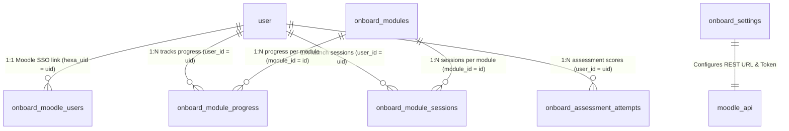

# 🗄 HexaLearn Onboarding Database Architecture & Schema Reference

This document provides a complete guide to the database architecture of the **HexaLearn Onboarding Portal**, detailing which tables are used, what data is stored in each column, and how each table connects with **HexaOne** and **Moodle LMS**.

---

## 📋 Table of Contents
1. [Architecture Overview](#-architecture-overview)
2. [Entity-Relationship Diagram](#-entity-relationship-diagram)
3. [The 7 Active Tables Reference](#-the-7-active-tables-reference)
   - [1. onboard_moodle_users](#1-onboard_moodle_users)
   - [2. onboard_modules](#2-onboard_modules)
   - [3. onboard_module_progress](#3-onboard_module_progress)
   - [4. onboard_module_sessions](#4-onboard_module_sessions)
   - [5. onboard_assessment_attempts](#5-onboard_assessment_attempts)
   - [6. onboard_settings](#6-onboard_settings)
   - [7. onboard_question_types](#7-onboard_question_types)
4. [Master Employee Table Linkage (`user`)](#-master-employee-table-linkage-user)
5. [Useful SQL Queries for Admins](#-useful-sql-queries-for-admins)
6. [Legacy Prototype Tables Note](#-legacy-prototype-tables-note)

---

## 🌟 Architecture Overview

The database uses a lean, production-grade schema where **Moodle LMS** acts as the primary e-learning engine (SCORM tracking, completion triggers, quiz grades), while MySQL maintains localized caches, SSO linkages, and audit telemetry.

- **Primary Database**: `hex-timesheet` / `u413479707_timesheet`
- **Employee Master**: Stored in the existing corporate `user` table.
- **Onboarding Specific Tables**: Prefixed with **`onboard_*`** to prevent namespace collisions.

---

## 🔄 Entity-Relationship Diagram



---

## 📊 The 7 Active Tables Reference

### 1. `onboard_moodle_users`
**Purpose**: The central Single Sign-On (SSO) bridging table. Maps an employee's HexaOne account to their Moodle LMS user account so employees can launch courses seamlessly without entering a second password.

| Column | Type | Nullable | Key | Default | Description |
| :--- | :--- | :---: | :---: | :--- | :--- |
| `id` | `INT(11)` | NO | PRI | *AUTO_INC* | Unique record ID |
| `hexa_uid` | `INT(11)` | NO | UNI | `NULL` | Foreign key matching `user.uid` in HexaOne |
| `username` | `VARCHAR(100)` | YES | | `NULL` | Convenience copy of HexaOne username for admin auditing |
| `moodle_user_id` | `INT(11)` | YES | UNI | `NULL` | The user ID generated by Moodle LMS |
| `sync_status` | `ENUM` | YES | | `'Not linked'` | Status: `'Not linked'`, `'Pending verification'`, `'Linked'`, `'Error'` |
| `last_synced_at` | `DATETIME` | YES | | `NULL` | Timestamp of the last successful Moodle sync |
| `notes` | `TEXT` | YES | | `NULL` | Audit log (e.g., "Auto-synced and enrolled in Moodle") |
| `created_at` | `DATETIME` | YES | | `CURRENT_TIMESTAMP` | Record creation date |
| `updated_at` | `DATETIME` | YES | | `CURRENT_TIMESTAMP` | Last updated timestamp |

- **Used in**: [`api/moodle/sync_user.php`](file:///d:/xaamp/htdocs/onboard/api/moodle/sync_user.php), [`api/moodle/launch.php`](file:///d:/xaamp/htdocs/onboard/api/moodle/launch.php), [`api/moodle/courses.php`](file:///d:/xaamp/htdocs/onboard/api/moodle/courses.php).

---

### 2. `onboard_modules`
**Purpose**: Stores the catalog of onboarding induction modules and courses displayed on the Dashboard, Roadmap, and Course Catalog.

| Column | Type | Nullable | Key | Default | Description |
| :--- | :--- | :---: | :---: | :--- | :--- |
| `id` | `INT(11)` | NO | PRI | *AUTO_INC* | Unique Module ID |
| `title` | `VARCHAR(255)` | NO | | `NULL` | Display title of the module (e.g., "Welcome to HexaLearn") |
| `description` | `TEXT` | YES | | `NULL` | Detailed description and learning objectives |
| `type` | `VARCHAR(50)` | YES | | `'scorm'` | Type of content: `'scorm'`, `'video'`, `'document'` |
| `duration_minutes`| `INT(11)` | YES | | `30` | Estimated duration in minutes |
| `roadmap_day` | `INT(11)` | YES | | `1` | Induction phase day (Day 1, Day 30, Day 60, Day 90) |
| `sort_order` | `INT(11)` | YES | | `0` | Order of presentation in UI |
| `is_active` | `TINYINT(1)` | YES | | `1` | 1 = Visible to employees, 0 = Inactive |
| `moodle_course_id`| `INT(11)` | YES | MUL | `NULL` | Corresponding course ID in Moodle LMS |
| `moodle_cmid` | `INT(11)` | YES | | `NULL` | Course module ID in Moodle |
| `moodle_scoid` | `INT(11)` | YES | | `NULL` | Launchable SCO ID inside Moodle SCORM package |
| `passing_score` | `INT(11)` | YES | | `80` | Required passing score percentage (default: 80%) |
| `created_at` | `DATETIME` | YES | | `CURRENT_TIMESTAMP` | Creation timestamp |

- **Used in**: [`api/dashboard/summary.php`](file:///d:/xaamp/htdocs/onboard/api/dashboard/summary.php), [`api/modules/list.php`](file:///d:/xaamp/htdocs/onboard/api/modules/list.php), [`api/admin/employees.php`](file:///d:/xaamp/htdocs/onboard/api/admin/employees.php).

---

### 3. `onboard_module_progress`
**Purpose**: Tracks each individual employee's real-time completion status, progress percentage, and time spent on each module. Synced live from Moodle SCORM tracking (`cmi.core.lesson_status`, `cmi.core.score.raw`, `cmi.core.total_time`).

| Column | Type | Nullable | Key | Default | Description |
| :--- | :--- | :---: | :---: | :--- | :--- |
| `id` | `INT(11)` | NO | PRI | *AUTO_INC* | Unique progress ID |
| `user_id` | `INT(11)` | NO | MUL | `NULL` | Employee ID (`user.uid`) |
| `module_id` | `INT(11)` | NO | | `NULL` | Module ID (`onboard_modules.id`) |
| `status` | `ENUM` | YES | | `'not_started'` | `'not_started'`, `'in_progress'`, `'completed'`, `'failed'` |
| `is_completed` | `TINYINT(1)` | YES | | `0` | 1 = Finished, 0 = Pending |
| `progress_percent`| `INT(11)` | YES | | `0` | Progress from 0% to 100% |
| `highest_progress_percent`| `INT(11)` | YES | | `0` | Highest watermark progress reached |
| `score` | `DECIMAL(5,2)`| YES | | `NULL` | Latest score achieved in SCORM quiz |
| `highest_score` | `DECIMAL(5,2)`| YES | | `NULL` | Best score across all attempts |
| `total_time` | `VARCHAR(32)`| YES | | `'00:00:00'` | Formatted total time spent (HH:MM:SS) |
| `total_time_seconds`| `INT(10) UNSIGNED` | YES | | `0` | Total time spent in raw seconds |
| `attempts` | `INT(11)` | YES | | `0` | Number of times module was launched |
| `slides_viewed` | `INT(10) UNSIGNED` | YES | | `0` | Number of slides completed |
| `total_slides` | `INT(10) UNSIGNED` | YES | | `0` | Total slides in the module |
| `started_at` | `DATETIME` | YES | | `NULL` | First start date/time |
| `completed_at` | `DATETIME` | YES | | `NULL` | Completion date/time |
| `last_synced_at`| `DATETIME` | YES | | `CURRENT_TIMESTAMP` | Last sync with Moodle telemetry |

- **Used in**: [`api/moodle/courses.php`](file:///d:/xaamp/htdocs/onboard/api/moodle/courses.php), [`api/dashboard/summary.php`](file:///d:/xaamp/htdocs/onboard/api/dashboard/summary.php), [`src/pages/Dashboard.tsx`](file:///d:/xaamp/htdocs/onboard/src/pages/Dashboard.tsx), [`src/pages/ScormReportPage.tsx`](file:///d:/xaamp/htdocs/onboard/src/pages/ScormReportPage.tsx).

---

### 4. `onboard_module_sessions`
**Purpose**: Fine-grained telemetry and audit logs of individual learning sessions. Created each time an employee launches and studies a module.

| Column | Type | Nullable | Key | Default | Description |
| :--- | :--- | :---: | :---: | :--- | :--- |
| `id` | `INT(11)` | NO | PRI | *AUTO_INC* | Session record ID |
| `user_id` | `INT(11)` | NO | MUL | `NULL` | Employee ID (`user.uid`) |
| `module_id` | `INT(11)` | NO | | `NULL` | Module ID (`onboard_modules.id`) |
| `session_time` | `VARCHAR(32)`| YES | | `'00:00:00'` | Formatted duration of this specific session |
| `session_seconds`| `INT(10) UNSIGNED`| YES | | `0` | Session duration in seconds |
| `progress_percent`| `INT(11)` | YES | | `0` | Progress reached during this session |
| `score` | `DECIMAL(5,2)`| YES | | `NULL` | Score achieved during this session |
| `status` | `VARCHAR(32)`| YES | | `NULL` | Status recorded at end of session |
| `recorded_at` | `DATETIME` | YES | | `CURRENT_TIMESTAMP` | Timestamp of session |

- **Used in**: [`api/moodle/sync_user.php`](file:///d:/xaamp/htdocs/onboard/api/moodle/sync_user.php), [`api/admin/employee_progress.php`](file:///d:/xaamp/htdocs/onboard/api/admin/employee_progress.php).

---

### 5. `onboard_assessment_attempts`
**Purpose**: Historical audit log of employee assessment attempts, scores, and pass/fail statuses.

| Column | Type | Nullable | Key | Default | Description |
| :--- | :--- | :---: | :---: | :--- | :--- |
| `id` | `INT(11)` | NO | PRI | *AUTO_INC* | Attempt record ID |
| `assessment_id` | `INT(11)` | NO | | `NULL` | Assessment identifier |
| `user_id` | `INT(11)` | NO | MUL | `NULL` | Employee ID (`user.uid`) |
| `score` | `DECIMAL(5,2)`| YES | | `NULL` | Score obtained (e.g. 85.00) |
| `max_score` | `INT(11)` | YES | | `100` | Maximum possible score (typically 100) |
| `is_passed` | `TINYINT(1)` | YES | | `NULL` | 1 = Passed, 0 = Failed |
| `started_at` | `DATETIME` | YES | | `CURRENT_TIMESTAMP` | Attempt start timestamp |
| `submitted_at` | `DATETIME` | YES | | `NULL` | Submission completion timestamp |

- **Used in**: [`api/dashboard/summary.php`](file:///d:/xaamp/htdocs/onboard/api/dashboard/summary.php), [`src/pages/AttemptHistoryPage.tsx`](file:///d:/xaamp/htdocs/onboard/src/pages/AttemptHistoryPage.tsx), [`api/admin/employee_progress.php`](file:///d:/xaamp/htdocs/onboard/api/admin/employee_progress.php).

---

### 6. `onboard_settings`
**Purpose**: Key-value system configuration store holding Moodle LMS API endpoints, WebService tokens, and global onboarding parameters.

| Column | Type | Nullable | Key | Default | Description |
| :--- | :--- | :---: | :---: | :--- | :--- |
| `key` | `VARCHAR(191)`| NO | PRI | `NULL` | Setting name (e.g., `'moodle_base_url'`, `'moodle_wstoken'`) |
| `value` | `LONGTEXT` | YES | | `NULL` | Setting value string / token |
| `updated_at` | `TIMESTAMP` | NO | | `CURRENT_TIMESTAMP` | Last updated timestamp |

- **Used in**: [`api/moodle/config.php`](file:///d:/xaamp/htdocs/onboard/api/moodle/config.php), [`api/moodle/client.php`](file:///d:/xaamp/htdocs/onboard/api/moodle/client.php), [`api/settings/get.php`](file:///d:/xaamp/htdocs/onboard/api/settings/get.php), [`api/settings/set.php`](file:///d:/xaamp/htdocs/onboard/api/settings/set.php).

---

### 7. `onboard_question_types`
**Purpose**: System reference lookup table defining supported quiz question interaction types.

| Column | Type | Nullable | Key | Default | Description |
| :--- | :--- | :---: | :---: | :--- | :--- |
| `id` | `INT(11)` | NO | PRI | *AUTO_INC* | Type ID |
| `type_code` | `VARCHAR(50)` | NO | UNI | `NULL` | Code: `'single_choice'`, `'multiple_choice'`, `'true_false'`, `'text'`, `'matching'`, `'reorder'` |
| `type_name` | `VARCHAR(100)`| NO | | `NULL` | Human-readable label (e.g., "Single Choice (Radio)") |
| `description` | `VARCHAR(255)`| YES | | `NULL` | Explanation of how the question functions |
| `is_active` | `TINYINT(1)` | NO | | `1` | 1 = Enabled, 0 = Disabled |

---

## 👥 Master Employee Table Linkage (`user`)

The onboarding database is built to extend the company's existing **`user`** table without altering its core schema.

```sql
-- How onboard data links to the employee profile:
SELECT 
    u.uid,
    u.username,
    CONCAT(u.firstname, ' ', u.lastname) AS employee_name,
    u.ofc_mail,
    d.name AS department_name,
    mu.moodle_user_id,
    mu.sync_status,
    p.progress_percent,
    p.is_completed,
    p.total_time
FROM user u
LEFT JOIN department d ON d.id = CAST(u.department AS UNSIGNED)
LEFT JOIN onboard_moodle_users mu ON mu.hexa_uid = u.uid
LEFT JOIN onboard_module_progress p ON p.user_id = u.uid
WHERE u.status = 0; -- Only active employees
```

---

## 🔍 Useful SQL Queries for Admins

### 1. Check an Employee's Overall Progress
```sql
SELECT 
    u.username,
    m.title AS course_title,
    p.progress_percent,
    p.is_completed,
    p.total_time,
    p.last_synced_at
FROM onboard_module_progress p
JOIN user u ON u.uid = p.user_id
JOIN onboard_modules m ON m.id = p.module_id
WHERE u.username = 'ashisr';
```

### 2. Verify Moodle Account Sync Status
```sql
SELECT 
    u.uid AS hexa_uid,
    u.username,
    mu.moodle_user_id,
    mu.sync_status,
    mu.last_synced_at,
    mu.notes
FROM onboard_moodle_users mu
JOIN user u ON u.uid = mu.hexa_uid;
```

### 3. Check Assessment Attempt Scores
```sql
SELECT 
    u.username,
    a.assessment_id,
    a.score,
    a.is_passed,
    a.started_at,
    a.submitted_at
FROM onboard_assessment_attempts a
JOIN user u ON u.uid = a.user_id
ORDER BY a.started_at DESC;
```

---

## 🧹 Legacy Prototype Tables Note

During early development, 20 dummy admin tables existed for prototype quiz banks (such as `onboard_assessments`, `onboard_pools`, `onboard_pool_questions`, `onboard_question_options`, `onboard_buddies`, etc.).

Because the portal now runs live with **Moodle LMS SCORM APIs**, all 20 legacy dummy tables were permanently dropped using [`clean_unused_tables.php`](file:///d:/xaamp/htdocs/onboard/clean_unused_tables.php), leaving the clean 7-table schema documented above.
