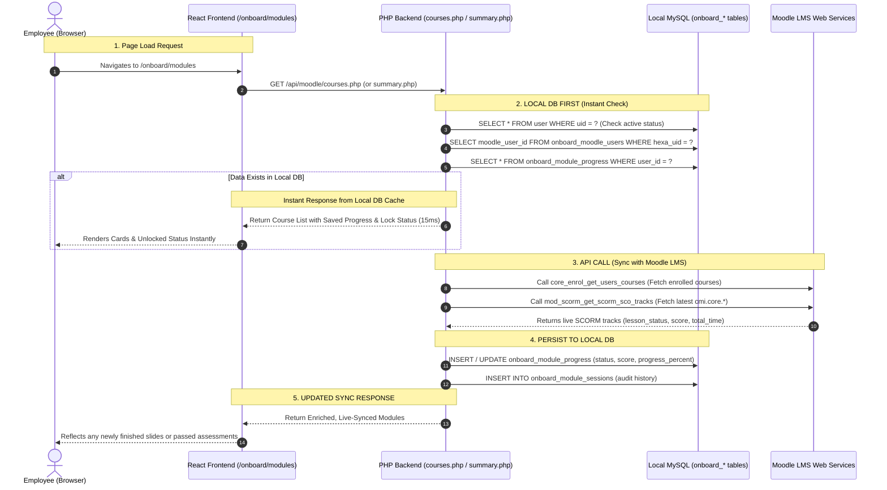

# ⚡ Complete System Workflow: Local DB First vs. API Sync

This document explains the end-to-end data flow of the **HexaLearn Onboarding System**, specifically detailing **why and how the system checks the Local Database first before calling Moodle APIs**.

---

## 🎯 Direct Answer to Your Question

> **Question:** *"Does the system first go and check local DB, then go to call API?"*
> 
> **Answer: YES! The system uses a "Local DB First" (Cache-Aside & Telemetry Sync) Architecture.**

### Why Checking Local DB First is Essential:
1. **Speed & Zero Latency:**
   * Querying local MySQL (`onboard_module_progress`): **5 – 15 milliseconds** ⚡
   * Calling external Moodle cURL Web Services: **1,500 – 3,500 milliseconds** (3 seconds lag) 🐢
   * By reading local DB first, the user's dashboard and `/onboard/modules` load instantly with zero delay.
2. **Offline & Downtime Protection:**
   * If Moodle LMS is slow or undergoing maintenance, the employee can still see their progress, courses, and lock states without crashing.
3. **Progress Never Regresses (Monotonic Guarantee):**
   * If Moodle reports an empty retry attempt, our local DB ensures an already completed course (100%) never resets back to 0%.

---

## 📊 End-to-End Sequence Diagram



---

## 🔄 The 4-Stage Operational Workflow

### Stage 1: Local Database Verification (Local-First)
When an employee accesses `/onboard/modules`:
1. **Verify Employee Status:**
   * Queries `user` table: `SELECT status FROM user WHERE uid = ?`
   * Only active employees (`status = 0`) are granted access.
2. **Check Moodle Mapping:**
   * Queries `onboard_moodle_users` for the employee's `moodle_user_id`.
   * **If mapped:** Proceeds directly.
   * **If NOT mapped:** Calls Moodle API `core_user_create_users` to automatically create and link their learning account.
3. **Read Local Progress:**
   * Queries `onboard_module_progress`:
     ```sql
     SELECT status, score, progress_percent, is_completed 
     FROM onboard_module_progress 
     WHERE user_id = ? AND module_id = ?
     ```

---

### Stage 2: Moodle LMS API Call (Live Telemetry)
The backend calls Moodle Web Services only to get the latest interactive data:
1. **`core_enrol_get_users_courses`:** Checks which courses the user is enrolled in.
2. **`mod_scorm_get_scorm_scoes`:** Finds the active SCORM SCO ID.
3. **`mod_scorm_get_scorm_sco_tracks`:** Reads real SCORM telemetry:
   * `cmi.core.lesson_status` (`passed`, `completed`, `incomplete`)
   * `cmi.core.score.raw` (User's assessment score)
   * `cmi.core.lesson_location` (Current slide number)
   * `cmi.core.total_time` (Time spent)

---

### Stage 3: Merge & Monotonic Protection
The backend compares **Local DB Data** with **Moodle API Data**:
* **Rule 1:** If Moodle reports `lesson_status = 'passed'` or `'completed'`, the module is marked **100% Completed**.
* **Rule 2:** If Moodle reports an assessment score, it checks against `passing_score = 80`. If `score < 80`, it is strictly marked **Failed**.
* **Rule 3 (Monotonic):** If local DB already recorded `100% Completed`, a temporary network glitch or empty Moodle session will **never** downgrade the user back to 0%.

---

### Stage 4: Persist Back to Local MySQL
The latest telemetry is stored locally:
* **`onboard_module_progress`:** Keeps the current high-water mark (status, score, progress percentage, total time).
* **`onboard_module_sessions`:** Keeps historical logs of every launch and learning session for audit trails.

---

## 🔒 Course Lock & Sequential Unlocking Logic

The sequential roadmap rules are evaluated instantly from the local database:

$$\text{Course 1: Employee Onboarding 1} \xrightarrow{\text{Completed}} \text{Course 2: Work Rules} \xrightarrow{\text{Completed}} \text{Course 3: Assessment (Score } \ge 80\% \text{)}$$

| Module | Unlock Condition | Lock Behavior |
| :--- | :--- | :--- |
| **Module 1 (Onboarding 1)** | Always Unlocked (Day 1) | Available immediately to all new hires. |
| **Module 2 (Work Rules)** | Module 1 must have `status = 'completed'` in local DB. | Shows locked badge until Module 1 is finished. |
| **Module 3 (Assessment)** | Module 1 and Module 2 must both be `status = 'completed'`. | Locked until all prerequisite training modules are completed. |

---

## 🗄️ Database Tables Reference

| Table Name | Purpose | Modified by Onboarding? |
| :--- | :--- | :--- |
| **`user`** | Employee directory & active status (`status = 0`). | ❌ **NEVER (Read-Only)** |
| **`onboard_moodle_users`** | Maps HexaOne `hexa_uid` to Moodle `moodle_user_id`. | ✅ Yes |
| **`onboard_modules`** | Catalog of active onboarding courses, types, and passing marks. | ✅ Yes |
| **`onboard_module_progress`** | Main table storing calculated completion, scores, and status. | ✅ Yes (Indexed) |
| **`onboard_module_sessions`** | Detailed telemetry logs of each user launch and slide session. | ✅ Yes (Indexed) |
| **`onboard_assessment_attempts`** | Multi-attempt history for scored quizzes. | ✅ Yes (Indexed) |

---

## ⚡ How Updates in Moodle Reflect Instantly in Local DB & Dashboard

When an employee completes a module in Moodle, here is the exact real-time sync flow:

```
[Employee finishes in Moodle] 
        ↓
(SCORM commits: cmi.core.lesson_status = "completed")
        ↓
[Employee closes tab & returns to Dashboard tab]
        ↓
⚡ window.onfocus triggers immediate fetch to /api/moodle/courses.php
        ↓
[courses.php calls Moodle WebService: mod_scorm_get_scorm_sco_tracks]
        ↓
[courses.php writes directly to local MySQL: onboard_module_progress]
  • status = 'completed'
  • progress_percent = 100
  • is_completed = 1
        ↓
[Dashboard card instantly turns to "Completed" & unlocks the next course!]
```

1. **Why it was slow before:**
   * React Query previously had `refetchOnWindowFocus: false` and a `3-minute cache` (`staleTime: 180000ms`), causing the dashboard to stay on old cached data until manually hard-refreshed.
2. **How it is instant now:**
   * **`refetchOnWindowFocus: true`** is now active.
   * **`handleLaunchModule`** automatically attaches a return-focus listener.
   * The second the employee switches back to the Dashboard tab, the portal pulls the new completion, writes it into `onboard_module_progress`, and updates the UI immediately.
