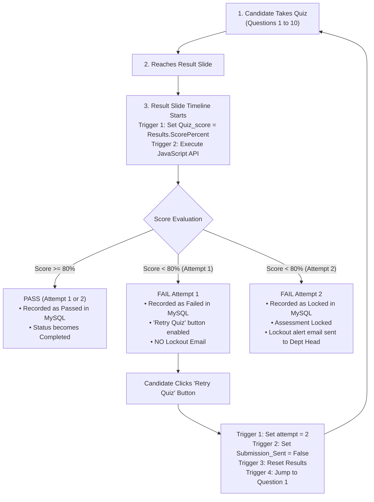

# Articulate Storyline Developer Guide: Induction Assessment (Step-by-Step)

This guide provides an exact, numbered, step-by-step walkthrough for Articulate Storyline developers to configure variables, slides, triggers, and JavaScript tracking for the **HexaLearn Induction Assessment (Course ID: 3 / Module 6)**.

---

## Quick Overview: How It Works



---

## STEP 1: Create Project Variables

In Articulate Storyline, open **Project Variables** (`Ctrl + Shift + V` or click `Manage Project Variables` in the Trigger panel) and add these **3 variables**:

| # | Variable Name | Type | Default Value | Description |
|---|---|---|---|---|
| **1** | `attempt` | **Number** | `1` | Tracks the active attempt (`1` for initial try, `2` for retake). |
| **2** | `Quiz_score` | **Number** | `0` | Holds the candidate's final quiz score percentage (0–100). |
| **3** | `Submission_Sent` | **True/False** | `False` | Prevents duplicate API submissions when reviewing the result slide. |

> [!IMPORTANT]
> Variable names are **case-sensitive**. Name them exactly as shown: `attempt`, `Quiz_score`, and `Submission_Sent`.

---

## STEP 2: Question Slides Setup

- Create your standard Graded Question slides (e.g., Multiple Choice, True/False).
- **Rule**: Do **NOT** add any custom JavaScript triggers to Question slides. Let Storyline track normal answers and scoring natively.

---

## STEP 3: Result Slide Setup (Base Layer)

On your **Result Slide** (the slide that displays your quiz score and pass/fail message), create **2 triggers** on the **Base Layer** in this exact order:

### Trigger 1: Copy Score to `Quiz_score` Variable
* **Action**: `Adjust variable`
* **Variable**: `Quiz_score`
* **Operator**: `= Set`
* **Value**: Variable `Results.ScorePercent` *(or `Results1.ScorePercent` depending on your quiz name)*
* **When**: `Timeline starts on this slide`

---

### Trigger 2: Send Score to HexaLearn API
* **Action**: `Execute JavaScript`
* **Script**: *(Paste the JavaScript code from STEP 5 below)*
* **When**: `Timeline starts on this slide`

> [!NOTE]
> Trigger 1 must always be placed **above** Trigger 2 so that `Quiz_score` is updated before the JavaScript executes.

---

## STEP 4: Failure Layer & "Retry Quiz" Button Setup

When a candidate scores below 80%, Storyline shows the **Failure Layer**. Place the **Retry Quiz** button on this layer.

### Triggers on the "Retry Quiz" Button (Exact Order):
Select the **Retry Quiz** button and add these **4 triggers** in this exact sequence:

```
Trigger 1: Set attempt = 2 (When user clicks)
Trigger 2: Set Submission_Sent = False (When user clicks)
Trigger 3: Reset Results Results (When user clicks)
Trigger 4: Jump to Slide Question 1 (When user clicks)
```

#### Detailed Trigger Settings:
1. **Trigger 1**:
   * **Action**: `Adjust variable`
   * **Variable**: `attempt`
   * **Operator**: `= Set`
   * **Value**: `2`
   * **When**: `User clicks this button`

2. **Trigger 2**:
   * **Action**: `Adjust variable`
   * **Variable**: `Submission_Sent`
   * **Operator**: `= Set`
   * **Value**: `False`
   * **When**: `User clicks this button`

3. **Trigger 3**:
   * **Action**: `Reset Results`
   * **Quiz**: `Results` *(Your result slide)*
   * **When**: `User clicks this button`

4. **Trigger 4**:
   * **Action**: `Jump to slide`
   * **Slide**: `Question 1` *(First question slide)*
   * **When**: `User clicks this button`

---

### Preventing a 3rd Attempt (Max 2 Attempts Rule)
On the Failure Layer, candidates are only allowed **2 total attempts**:

1. **Option A (Condition on Button)**:
   Add a condition to the "Retry Quiz" button:
   * Show / Enable button only **If `attempt` == 1**.
2. **Option B (Layer Change)**:
   Create a dedicated layer or textbox that says:
   > *"You have completed both allowable attempts (Attempt 1 and Attempt 2). Your assessment is now locked. Please contact your Department Head or Administrator."*
   * Set this message to show **If `attempt` == 2**.

---

## STEP 5: JavaScript Code to Paste into Trigger 2

Paste this exact code into **Trigger 2** on the Result Slide:

```javascript
/**
 * HexaLearn CorHis Onboarding - Induction Assessment Storyline Tracker (v3 - Bulletproof)
 * Automatically retrieves Score, Attempt, and Moodle Student ID and posts to HexaLearn MySQL
 */
(function () {
    var player = GetPlayer();
    if (!player) {
        console.warn("[Assessment Track] Storyline Player not found.");
        return;
    }

    // 1. Guard against duplicate submission for the same slide visit
    var submissionSent = player.GetVar("Submission_Sent");
    if (submissionSent === true) {
        console.log("[Assessment Track] Score already submitted for this attempt.");
        return;
    }

    // Mark as submitted immediately to prevent race conditions
    if (typeof submissionSent !== "undefined" && submissionSent !== null) {
        player.SetVar("Submission_Sent", true);
    }

    // 2. Resolve Quiz Score (Checks Quiz_score variable first, fallbacks to Storyline native Results)
    var quizScore = Number(player.GetVar("Quiz_score"));
    if (isNaN(quizScore) || quizScore === 0) {
        quizScore = Number(player.GetVar("Results.ScorePercent")) || 
                    Number(player.GetVar("Results1.ScorePercent")) || 
                    0;
    }

    // 3. Resolve Attempt Number (Checks variable, then URL parameters)
    var attempt = Number(player.GetVar("attempt")) || 1;
    try {
        var urlParams = new URLSearchParams(window.location.search);
        if (urlParams.get("newattempt") === "on" || urlParams.get("attempt") === "2") {
            attempt = 2;
        }
    } catch (e) {}

    // 4. Retrieve Moodle SCORM 1.2 student_id from LMS iframe
    var lms = window.API || (window.parent && window.parent.API) || null;
    var studentId = null;
    if (lms) {
        try {
            studentId = lms.LMSGetValue("cmi.core.student_id");
        } catch (e) {
            console.warn("[Assessment Track] LMS student ID unavailable", e);
        }
    }

    console.log("[Assessment Track] Submitting to HexaLearn API:", {
        attempt: attempt,
        quiz_score: quizScore,
        student_id: studentId
    });

    // 5. Target the CorHis Assessment Tracking Endpoint
    var apiUrl = "https://corhis.hexalearn.com/onboard/api/moodle/track_assessment.php";

    fetch(apiUrl, {
        method: "POST",
        headers: {
            "Content-Type": "application/json"
        },
        credentials: "include",
        body: JSON.stringify({
            quiz_score: quizScore,
            attempt: attempt,
            student_id: studentId,
            course_id: 3,
            final_submit: true
        })
    })
    .then(function (res) {
        return res.json();
    })
    .then(function (data) {
        console.log("[Assessment Track] Saved successfully:", data);
    })
    .catch(function (err) {
        console.error("[Assessment Track] Network error:", err);
        // Allow retry on network failure
        if (typeof submissionSent !== "undefined" && submissionSent !== null) {
            player.SetVar("Submission_Sent", false);
        }
    });
})();
```

---

## STEP 6: Exactly When Does the API Trigger?

| Event / Action | When It Fires | What the API Does | What the Portal Shows |
|---|---|---|---|
| **Candidate completes Question 10 and reaches Result Slide** | As soon as the Result Slide appears on screen (`Timeline starts`) | **`track_assessment.php`** receives: `{ quiz_score, attempt, student_id }` and records the row in MySQL table `onboard_induction_assessment_attempts`. | **`/attempt-history`**: Shows Attempt 1 row, score %, Qualified or Failed.<br>**`/dashboard`**: Updates Assessment Status donut & score. |
| **Attempt 1 is Passed (Score $\ge$ 80%)** | Result Slide timeline starts | Sets `result = 'Passed'`. Assessment is marked Complete. | Status turns Green **Completed / Qualified**. |
| **Attempt 1 is Failed (Score $<$ 80%)** | Result Slide timeline starts | Sets `result = 'Failed'`, `is_locked = 0`. Candidate is eligible for retake. | Status turns **Retake Needed**. Candidate clicks **Retry Quiz** inside the player. |
| **Candidate clicks "Retry Quiz"** | On button click | Storyline sets `attempt = 2`, `Submission_Sent = False`, resets quiz questions. | Player returns to Question 1. |
| **Candidate finishes Attempt 2 and reaches Result Slide** | Result Slide timeline starts for Attempt 2 | **`track_assessment.php`** receives Attempt 2 score. | Shows Attempt 2 row in Attempt History. |
| **Attempt 2 is Failed (Score $<$ 80%)** | Result Slide timeline starts for Attempt 2 | Sets `is_locked = 1`.<br>Sends **Lockout Email** strictly ONCE to Department Head with CC to management. | Assessment is locked. Candidate sees **Attempts Exceeded**. Admin sees candidate on `/admin/assessments` with **Unlock** button. |

---

## STEP 7: Publishing Checklist for Moodle LMS

When publishing from Articulate Storyline:
1. Click **Publish** $\rightarrow$ select **LMS / LRS**.
2. **LMS**: Select **SCORM 1.2**.
3. **Tracking**:
   * Select: **When the learner views the results slide** (Select your Result Slide).
   * Or: **Using quiz result** $\rightarrow$ select your final quiz.
4. **Reporting**: Select **Passed / Incomplete** or **Passed / Failed**.
5. Zip the package and upload to Moodle **Course ID 3 (Employee Assessment)**.
