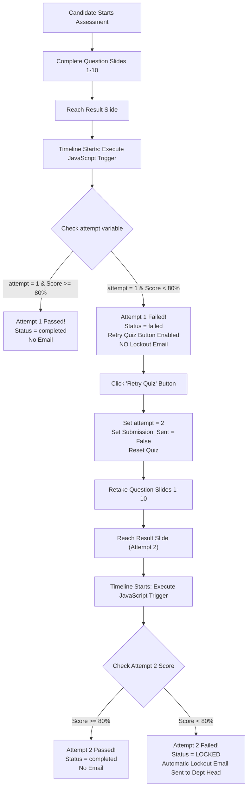

# Articulate Storyline Developer Guide: M11 Induction Assessment (v2 - Bulletproof)

This guide provides step-by-step instructions for Storyline developers to configure variables, triggers, and JavaScript tracking for the **HexaLearn CorHis Induction Assessment (Course ID 3 / Module 6)**.

---

## 1. Project Variables Setup

Open **Manage Project Variables** (`Ctrl + Shift + V`) in Articulate Storyline and define these **3 variables**:

| Variable Name | Type | Default Value | Description |
| :--- | :--- | :--- | :--- |
| **`attempt`** | **Number** | `1` | Tracks the active attempt (`1` for first try, `2` for retake). |
| **`Quiz_score`** | **Number** | `0` | Stores candidate's quiz percentage score (0–100%). |
| **`Submission_Sent`** | **True/False** | `False` | Prevents duplicate API submissions on the Result Slide. |

*(Note: `Final_Submit` is optional now; the updated script handles everything automatically).*

---

## 2. Trigger Configuration (Foolproof & Simple)

### A. On the Result Slide (When Timeline Starts)
Place this **single trigger** on the **Result Slide** (the slide showing Pass/Fail and score):

1. **Trigger:**
   * **Action**: `Execute JavaScript`
   * **Script**: *(Paste the JavaScript code from Section 3 below)*
   * **When**: `Timeline starts on this slide`

> [!TIP]
> That's it! No complex trigger order is needed on the Result Slide. When the candidate arrives on the Result Slide, Attempt 1 will automatically submit to the database and record in Attempt History!

---

### B. On the "Retry Quiz" Button (Failure Layer / Retake)
When a candidate scores below 80% on Attempt 1, Storyline displays the **Retry Quiz** button. 
Add these triggers to the **Retry Quiz** button in this order:

1. **Trigger 1**: Set `attempt` = `2` when user clicks this button.
2. **Trigger 2**: Set `Submission_Sent` = `False` when user clicks this button.
3. **Trigger 3**: Reset Results (Select your Quiz / Result Slide) when user clicks this button.
4. **Trigger 4**: Jump to Slide (Question 1) when user clicks this button.

---

### C. Slide Master & Question Slides Rule
* **CRITICAL**: Do **NOT** put any "Execute JavaScript" triggers on Question Slides or on Slide Master.
* The JavaScript trigger must reside **exclusively on the Result Slide**.

---

## 3. JavaScript Code for the Result Slide Trigger

Paste this exact code into the **Execute JavaScript** trigger on the Result Slide:

```javascript
/**
 * HexaLearn CorHis Onboarding - Induction Assessment Storyline Tracker (Bulletproof v2)
 */
(function () {
    var player = GetPlayer();
    if (!player) return;

    // 1. Prevent duplicate submissions for the same attempt
    var submissionSent = player.GetVar("Submission_Sent");
    if (submissionSent === true) {
        console.log("[Assessment Track] Already submitted for this attempt.");
        return;
    }

    // Mark as submitted immediately to prevent race conditions
    if (typeof submissionSent !== "undefined" && submissionSent !== null) {
        player.SetVar("Submission_Sent", true);
    }
    try {
        player.SetVar("Final_Submit", true);
    } catch (e) {}

    // 2. Read Storyline variables
    var quizScore = Number(player.GetVar("Quiz_score")) || 0;
    var attempt = Number(player.GetVar("attempt")) || 1;

    // 3. Retrieve Moodle SCORM 1.2 student_id if running inside LMS iframe
    var lms = window.API || (window.parent && window.parent.API) || null;
    var studentId = null;
    if (lms) {
        try {
            studentId = lms.LMSGetValue("cmi.core.student_id");
        } catch (e) {
            console.warn("Unable to retrieve Moodle student ID", e);
        }
    }

    console.log("[Assessment Track] Submitting Attempt " + attempt + " with Score: " + quizScore + "%", {
        attempt: attempt,
        quiz_score: quizScore,
        student_id: studentId
    });

    // 4. Target the CorHis Onboarding API endpoint
    var apiUrl = "https://corhis.hexalearn.com/onboard/api/moodle/track_assessment.php";

    fetch(apiUrl, {
        method: "POST",
        headers: {
            "Content-Type": "application/json"
        },
        credentials: "include",
        body: JSON.stringify({
            quiz_score: quizScore,
            attempt: attempt,
            student_id: studentId,
            course_id: 3,
            final_submit: true
        })
    })
        .then(function (res) {
            return res.json();
        })
        .then(function (data) {
            console.log("[Assessment Result Saved Successfully]", data);
        })
        .catch(function (err) {
            console.error("[Assessment Save Error]", err);
            // On network failure, allow retry
            if (typeof submissionSent !== "undefined" && submissionSent !== null) {
                player.SetVar("Submission_Sent", false);
            }
        });
})();
```

---

## 4. End-to-End Evaluation Flow


