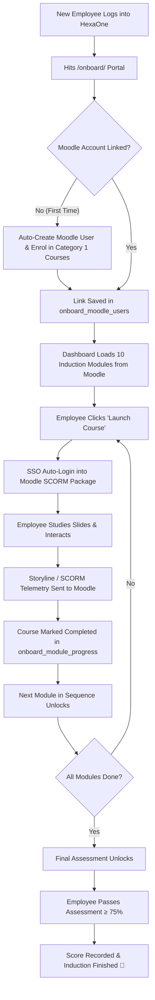

# 🚀 HexaLearn Onboarding: New Employee Journey & System Workflow

This document explains in a **short, clean, step-by-step way** exactly what happens from the moment a new employee joins and hits the portal for the very first time.

---

## 🧭 The End-to-End Workflow at a Glance

---

## ⚡ Step-by-Step Breakdown

### Step 1: Authentication & Landing
1. The new employee logs into **HexaOne Timesheet** (`hex-timesheet`).
2. They click on **Onboarding** (`/internal/hex-timesheet/onboard/`).
3. The React app immediately calls `/api/auth/status.php` to verify their session and confirm they are an active employee (`status = 0`).

---

### Step 2: Auto-Discovery & Zero-Admin Moodle Account Linking
*What happens on their very first visit:*
1. The backend checks `onboard_moodle_users` for the employee's `hexa_uid`.
2. **If this is a new hire who has never used Moodle:**
   - The portal automatically calls Moodle WebServices (`core_user_get_users_by_field` / `core_user_create_users`).
   - A Moodle user account is created using their HexaOne username, first/last name, and corporate email.
   - The user is automatically enrolled in all active Induction courses under Onboarding (Category 1).
   - The link is saved into MySQL table **`onboard_moodle_users`** (`sync_status = 'Linked'`).
3. **No HR or IT admin action is needed** — the link happens automatically in under 2 seconds.

---

### Step 3: Loading Induction Modules on Dashboard
1. The portal calls `/api/moodle/courses.php`.
2. Moodle returns all enrolled induction courses, SCORM modules, and any existing progress.
3. The employee sees the clean **Dashboard** and **Roadmap**:
   - **Course 1** is unlocked and ready to start.
   - **Courses 2–10** are locked until their prerequisites are completed.

---

### Step 4: Launching a Course via Seamless Single Sign-On (SSO)
1. The employee clicks **"Start Module"** or **"Launch Course"**.
2. The portal calls `/api/moodle/launch.php`.
3. A secure, signed single-use SSO URL is generated so the employee enters Moodle **without having to type a password**.
4. The SCORM e-learning module opens directly inside the modal player or new tab.
5. A session start timestamp is logged in **`onboard_module_sessions`**.

---

### Step 5: Real-Time SCORM Tracking & Automatic Unlocking
1. As the employee moves through the slides in Articulate Storyline, SCORM tracking (`cmi.core.lesson_status`, `cmi.core.score.raw`, `cmi.core.total_time`) is sent back to Moodle LMS.
2. When the employee reaches the final slide or passes the module quiz:
   - Moodle marks the status as **`completed`** / **`passed`**.
   - The status is synced into MySQL table **`onboard_module_progress`** (`is_completed = 1`, `progress_percent = 100`).
   - **The next course unlocks automatically** on their Dashboard and Roadmap.

---

### Step 6: Final Assessment & Completion
1. When all induction courses are finished, the **Final Assessment** unlocks.
2. The employee completes the assessment quiz.
3. Their score, pass/fail result, and timestamp are saved in **`onboard_assessment_attempts`**.
4. If passed ($\ge 75\%$), their induction journey is marked 100% complete!

---

## 📁 Related Documentation
- **[README.md](README.md)** — Project overview, local setup, and tech stack.
- **[README_DATABASE.md](README_DATABASE.md)** — Full 7-table schema, column definitions, and SQL queries.
